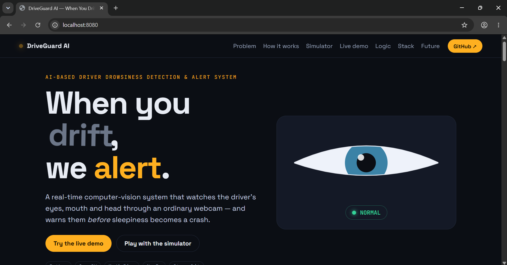
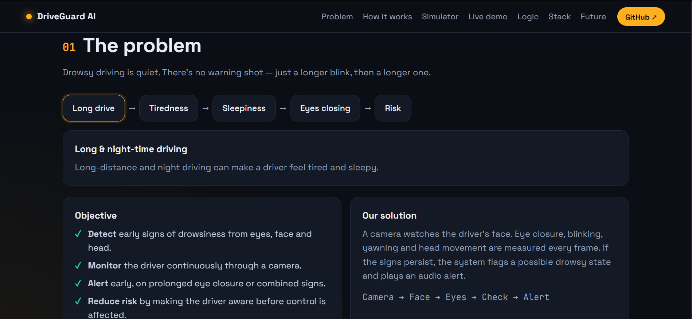
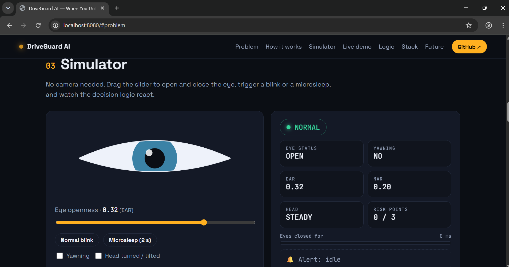

# DriveGuard AI
### When You Drift, We Alert.

DriveGuard AI is an AI-based driver drowsiness detection and alert system built using computer vision. It analyzes eye closure, yawning, and head position to identify signs of driver fatigue and trigger alerts.

### Project Screenshots

Home Page



How It Works


Problem Overview



Live Demo


Simulator



Fotter


## Features
- Real-time drowsiness detection using a webcam
- Eye closure and yawning detection
- Head position monitoring
- Risk levels with audio alerts
- Interactive simulator and browser-based demo

## Tech Stack
Python, OpenCV, MediaPipe, NumPy, Streamlit, HTML, CSS, JavaScript

## Run Locally

```bash
git clone https://github.com/pranavvv-git/DriveGuard-AI.git
cd DriveGuard-AI
python -m http.server 8000
```

Open `http://localhost:8000` in your browser.

## Author
**Pranav Thakur** · [GitHub](https://github.com/pranavvv-git)

*This project is for educational purposes and is not a replacement for safe driving or driver attention.*
